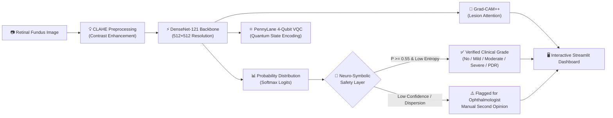
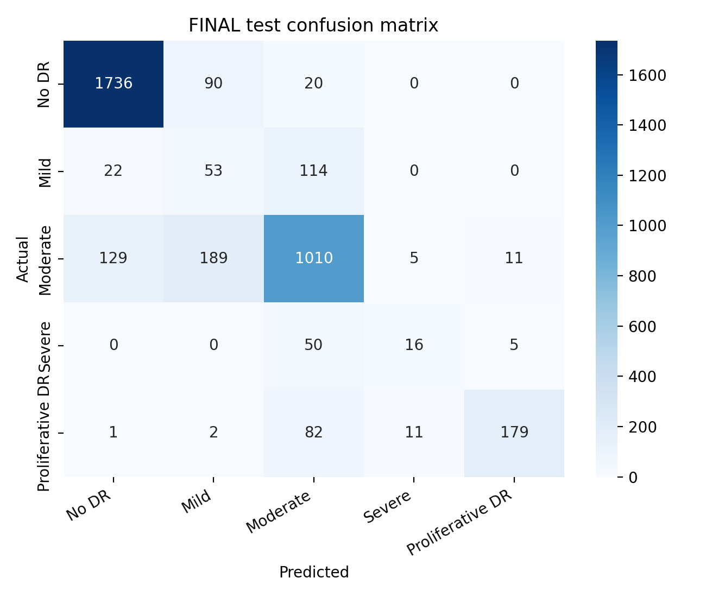
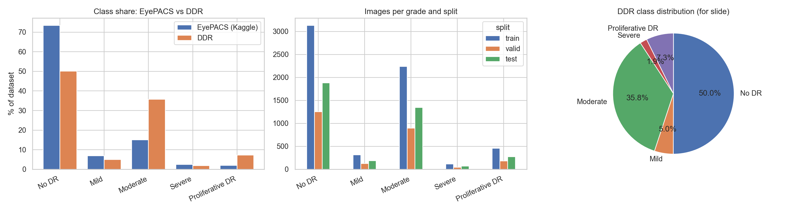
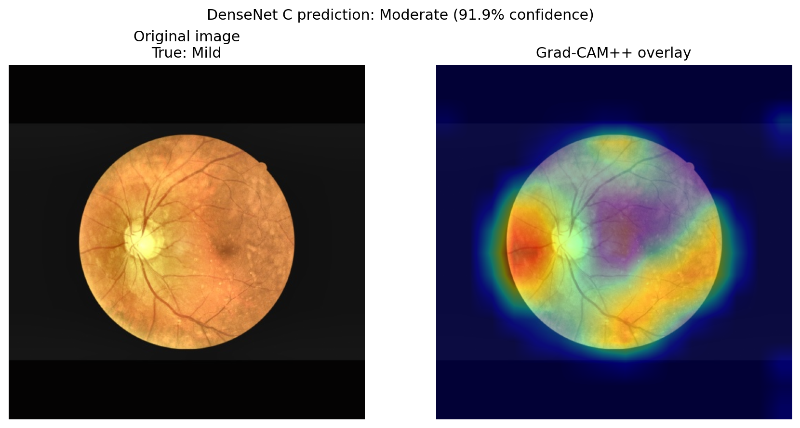
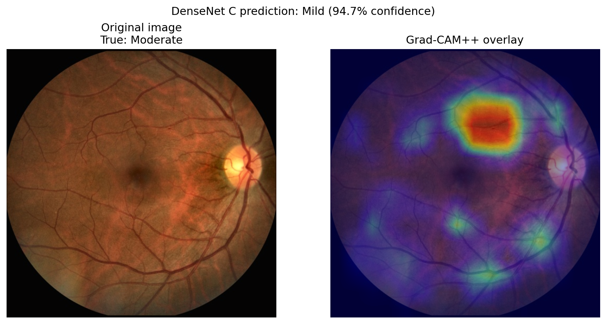
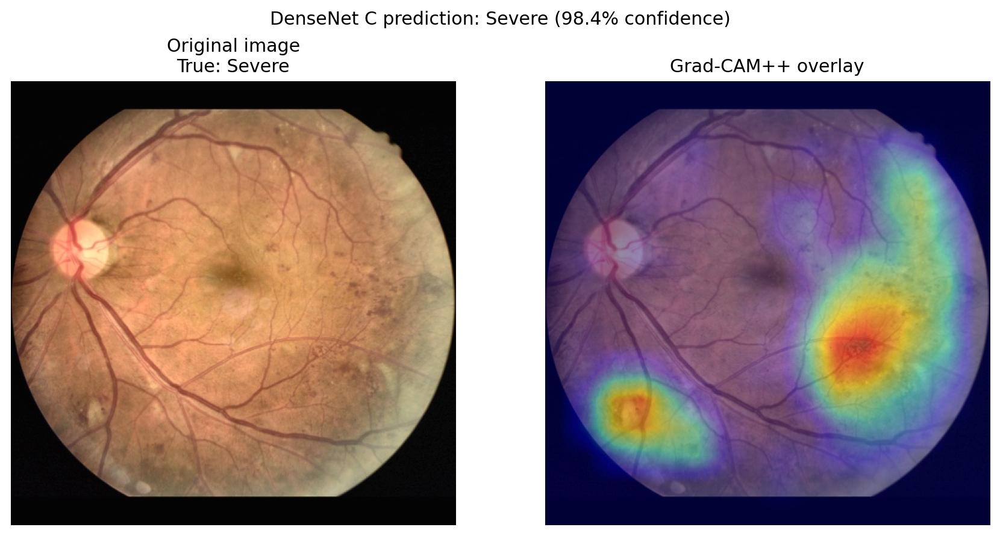
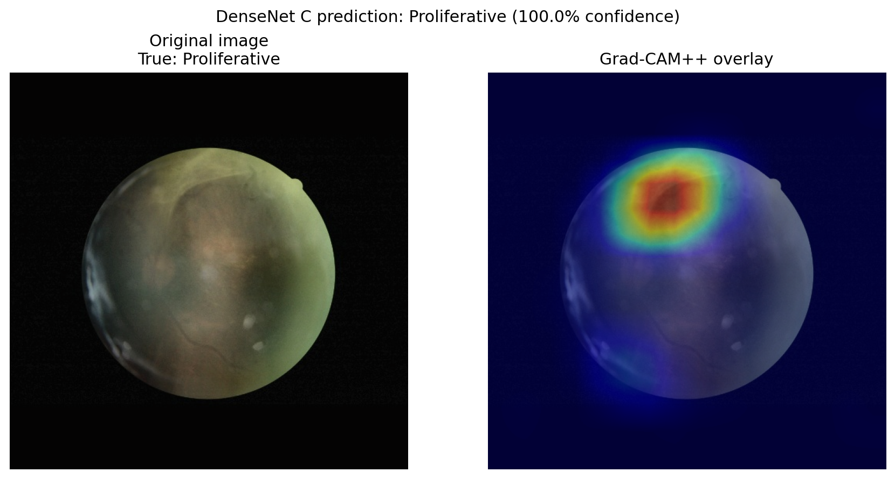

<div align="center">

# 👁️ RetinaAI: Next-Gen Diabetic Retinopathy Diagnostic System
### *DenseNet-121 Deep Neural Network • Variational Quantum Circuit (VQC) • Neuro-Symbolic Safety Layer • Grad-CAM++ Explainability*

[](https://www.python.org/)
[](https://pytorch.org/)
[](https://pennylane.ai/)
[](https://streamlit.io/)
[](LICENSE)
[](#-benchmark-results)

<p align="center">
  <b>A clinically grounded, explainable, and trustworthy AI framework for automated 5-stage Diabetic Retinopathy grading on retinal fundus photographs.</b>
</p>

[✨ Live Demo / Quickstart](#-quickstart-guide) •
[🧠 Architecture](#-system-architecture) •
[📊 Benchmark Results](#-benchmark-results) •
[🔬 Explainability (XAI)](#-grad-cam-lesion-localization) •
[👥 Contributors](#-contributors)

</div>

---

## 📖 Table of Contents
- [🌟 Project Overview](#-project-overview)
- [✨ Key Innovations](#-key-innovations)
- [🧠 System Architecture](#-system-architecture)
- [📊 Benchmark Results](#-benchmark-results)
- [🔬 Grad-CAM++ Lesion Localization](#-grad-cam-lesion-localization)
- [💻 Interactive Clinical Dashboard](#-interactive-clinical-dashboard)
- [🚀 Quickstart Guide](#-quickstart-guide)
- [📁 Project Structure](#-project-structure)
- [👥 Contributors](#-contributors)
- [📄 License](#-license)

---

## 🌟 Project Overview

**Diabetic Retinopathy (DR)** is one of the leading causes of preventable blindness in working-age adults globally. Early screening and timely intervention can reduce severe vision loss by over **90%**. However, high clinical workload and severe specialist shortages create critical bottlenecks in screening programs.

While traditional Convolutional Neural Networks (CNNs) achieve high nominal classification accuracy, clinical adoption requires:
1. **Ordinal Severity Awareness**: Distinguishing neighboring stages ($0 \to 1 \to 2 \to 3 \to 4$) accurately.
2. **Transparent Uncertainty**: Catching ambiguous or conflicting retinal scans before they reach a patient.
3. **Visual Biomarker Localization**: Explaining *why* the model predicted a specific grade using retinal landmarks.

**RetinaAI** addresses these challenges by uniting **fine-tuned DenseNet-121**, **PennyLane Variational Quantum Circuits (VQC)**, an explicit **Neuro-Symbolic verification layer**, and **Grad-CAM++** within an interactive clinical dashboard.

---

## ✨ Key Innovations

| Component | Technical Implementation | Clinical Advantage |
|---|---|---|
| **Deep Learning Backbone** | DenseNet-121 with CLAHE preprocessing (512×512) | Maximizes retinal feature reuse across deep layers without vanishing gradients. |
| **Hybrid Quantum Classifier** | 4-Qubit Variational Quantum Circuit (VQC) via PennyLane | Explores non-linear quantum Hilbert feature spaces for enhanced decision boundaries. |
| **Neuro-Symbolic Safety Layer** | Shannon entropy, adjacent grade mass, & confidence cutoffs | Automatically flags high-risk borderline cases for mandatory ophthalmologist review. |
| **Explainable AI (XAI)** | Grad-CAM++ on `features.denseblock4` | Highlights microaneurysms, hemorrhages, and neovascularization driving diagnoses. |
| **Clinical UI Frontend** | Streamlit + Custom Dark Glassmorphic CSS | One-click fundus upload, CLAHE enhancement toggle, and downloadable JSON clinical reports. |

---

## 🧠 System Architecture



### 📐 Neuro-Symbolic Safety Rule Specifications:
- **1. Minimum Confidence Barrier:** Requires peak confidence $P(\hat{y}) \ge 0.55$.
- **2. Adjacent Grade Probability Mass:** For ordinal stage $\hat{y}$, demands $\sum_{k=\max(0, \hat{y}-1)}^{\min(4, \hat{y}+1)} P(y=k) \ge 0.70$.
- **3. Shannon Uncertainty Entropy:** Bounded by $H(P) = -\sum P_k \log(P_k + \epsilon) \le 1.25$ to stop chaotic predictions.

---

## 📊 Benchmark Results

Evaluated rigorously on the **OIA-DDR held-out test split (3,759 retinal images)**:

<div align="center">

| Model Configuration | Quadratic Weighted Kappa (QWK) | Accuracy | Macro F1 | Weighted F1 |
|:---|:---:|:---:|:---:|:---:|
| **DenseNet-121 A (Argmax)** | 0.8107 | 81.53% | 0.6100 | 0.7912 |
| **DenseNet-121 B (Argmax)** | 0.8011 | 80.13% | 0.6128 | 0.7808 |
| **DenseNet Ensemble (Argmax)** | 0.8078 | 80.89% | 0.6116 | 0.7865 |
| **🏆 FINAL: Ensemble + Expected Cutoffs** | **0.8646** | **80.38%** | **0.5952** | **0.8021** |

</div>

<p align="center">
  
  
</p>

---

## 🔬 Grad-CAM++ Lesion Localization

Grad-CAM++ generates pixel-level attention overlays to ensure model predictions align with recognized medical pathology rather than dataset artifacts:

<div align="center">

| Grade 1: Mild DR (Microaneurysms) | Grade 2: Moderate DR (Hemorrhages & Exudates) |
|:---:|:---:|
|  |  |

| Grade 3: Severe DR (Venous Beading & IRMA) | Grade 4: Proliferative DR (Neovascularization) |
|:---:|:---:|
|  |  |

</div>

---

## 💻 Interactive Clinical Dashboard

The frontend in [`app.py`](app.py) + [`style.css`](style.css) provides a responsive, dark glassmorphic interface:
- **Instant Testing**: Upload any custom fundus photo or pick from pre-loaded clinical sample cases (Grades 0–4).
- **CLAHE Enhancement**: Real-time adjustable contrast preprocessing.
- **Dynamic Diagnostics**: Live severity badge, color-coded confidence bars, and safety flags.
- **Explainability Tab**: Full-resolution heatmap visualization.
- **JSON Clinical Report**: Export structured diagnostic summaries for hospital records.

---

## 🚀 Quickstart Guide

Get the complete application running locally in under 3 minutes:

### 1. Clone the Repository
```bash
git clone https://github.com/kjuhi-18/RetinaAI.git
cd RetinaAI
```

### 2. Create and Activate a Virtual Environment
```bash
# Windows (PowerShell)
python -m venv venv
.\venv\Scripts\Activate.ps1

# Linux / macOS
python3 -m venv venv
source venv/bin/activate
```

### 3. Install Dependencies
```bash
pip install torch torchvision streamlit pennylane opencv-python matplotlib pandas numpy scikit-learn pillow
```

### 4. Launch the Streamlit Frontend
```bash
streamlit run app.py
```
*Your browser will automatically open at `http://localhost:8501`!*

---

## 📁 Project Structure

```text
RetinaAI/
├── app.py                                                      # Streamlit web application
├── style.css                                                   # Custom glassmorphic CSS styling
├── .gitignore                                                  # Git exclusion rules
├── LICENSE                                                     # MIT License
├── README.md                                                   # Documentation
│
├── DR_Final_DenseNetC_VQC_NeuroSymbolic_GradCAMPP_Training.ipynb # Core training & evaluation notebook
├── LIDC_YNet_DenseNet_VQC_Classification.ipynb                  # LIDC experimental benchmark notebook
├── YNet_Capsule_DenseNet_VQC_Classification.ipynb               # Capsule network notebook
├── DR_DenseNet_VQC_Presentation.pdf                            # Project presentation slides
├── DR_DenseNet_VQC_Project_Report.pdf                          # Detailed project report
│
├── sample_images/                                              # Curated test fundus samples (Grades 0-4)
│   ├── sample_grade_0_no_dr.jpg
│   ├── sample_grade_1_mild.jpg
│   ├── sample_grade_2_moderate.jpg
│   ├── sample_grade_3_severe.jpg
│   └── sample_grade_4_proliferative.jpg
│
├── train_results_v2/                                           # Finalized 512x512 metrics & assets
│   ├── final_results.csv                                       # Benchmark comparison CSV
│   ├── final_rule.json                                         # Optimal cutoff thresholds
│   ├── final_confusion_matrix.png                              # Overall confusion matrix
│   └── final_model_package_outputs/                            # Grad-CAM++ panels & evaluation CSVs
│
└── eda_outputs/                                                # Dataset exploratory analysis
    ├── class_distribution.png                                  # Imbalance distribution chart
    ├── preprocessing_preview.png                               # CLAHE preprocessing visualization
    └── summary.json                                            # OIA-DDR dataset summary metrics
```

---

## 👥 Contributors

This project was built and developed collaboratively by:

<div align="center">

| Contributor | Focus Area |
|:---:|:---|
| <br> **Khushboo Talaviya** 
| <br> **Karunya Agarwal** 
| <br> **Kunal Jhindal** 

</div>

---


## 📄 License

This project is licensed under the [MIT License](LICENSE) - see the LICENSE file for details.

<div align="center">
  <sub>Built with ❤️ for accessible, transparent, and trustworthy medical healthcare.</sub>
</div>
